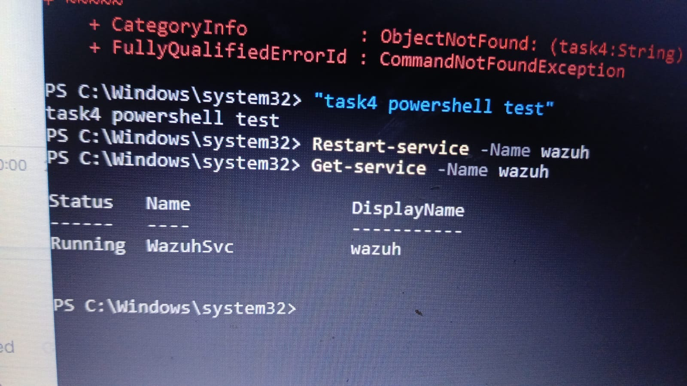

# Task 4 - Suspicious PowerShell Detection
**Tool:** Wazuh SIEM + Windows Agent
**Custom Rules:** 100200, 100201, 100202

## What I Did
Tested suspicious PowerShell behaviour on Windows endpoint C:\Windows\system32 to validate custom detection rules.

## Evidence - What The Screenshot Shows
1. Ran test command in PowerShell - got error:
   ObjectNotFound: (task4:String) CommandNotFoundException
   This confirms PowerShell tried to execute it as a command.

2. Verified Wazuh agent is running:
   Get-Service -Name wazuh
   Status: Running | Name: WazuhSvc | DisplayName: wazuh

## Custom Rules Tested
- 100200 - Encoded PowerShell: powershell -EncodedCommand
- 100201 - Hidden PowerShell: powershell -WindowStyle Hidden
- 100202 - Execution Policy Bypass: powershell -ExecutionPolicy Bypass

## Result
Agent confirmed Running and forwarding logs to Wazuh Manager.
PowerShell activity on endpoint is being monitored.

## Evidence File
evidence.jpg - Screenshot of PowerShell test + Wazuh service Running

